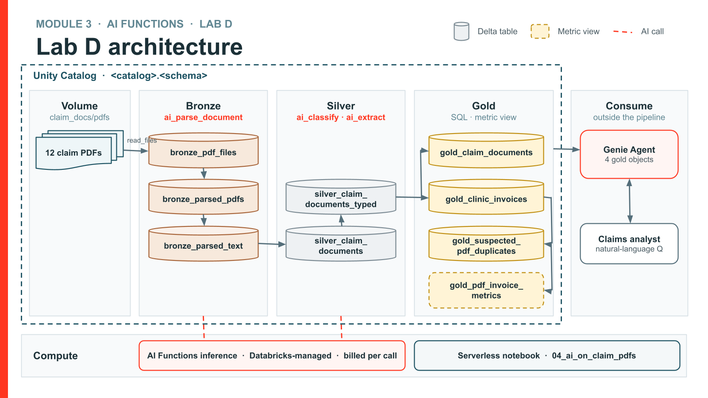
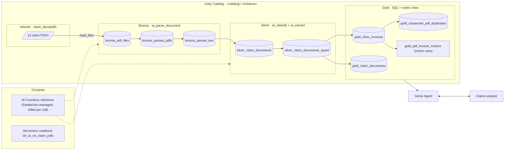

# Lab D Architecture — Claim PDFs → Genie

Workshop slice of the [multi-modal claims knowledge base](https://github.com/qian-yu-db/insurance-claim-knowledge-base/blob/main/docs/claims_kb_architecture.md).

Production normalizes every modality (PDF, email, audio, photos) to text and unifies into one index.
Lab D keeps **one modality — claim PDFs** — and stops at structured gold tables + Genie (no vector search).

| Step | AI Function | Tables |
|------|-------------|--------|
| Landing | — | PDFs from notebook `01` |
| Bronze | `ai_parse_document` | `bronze_pdf_files`, `bronze_parsed_pdfs`, `bronze_parsed_text` |
| Silver | `ai_classify` + `ai_extract` | `silver_claim_documents`, `silver_claim_documents_typed` |
| Gold | — | `gold_clinic_invoices`, `gold_suspected_pdf_duplicates`, `gold_pdf_invoice_metrics` |
| Genie | — | Agent over the gold tables |

**Planted check:** Sparky · Pine Vet Clinic · `2026-08-03` · `CLM-PET-00044` / `CLM-PET-00045`.
